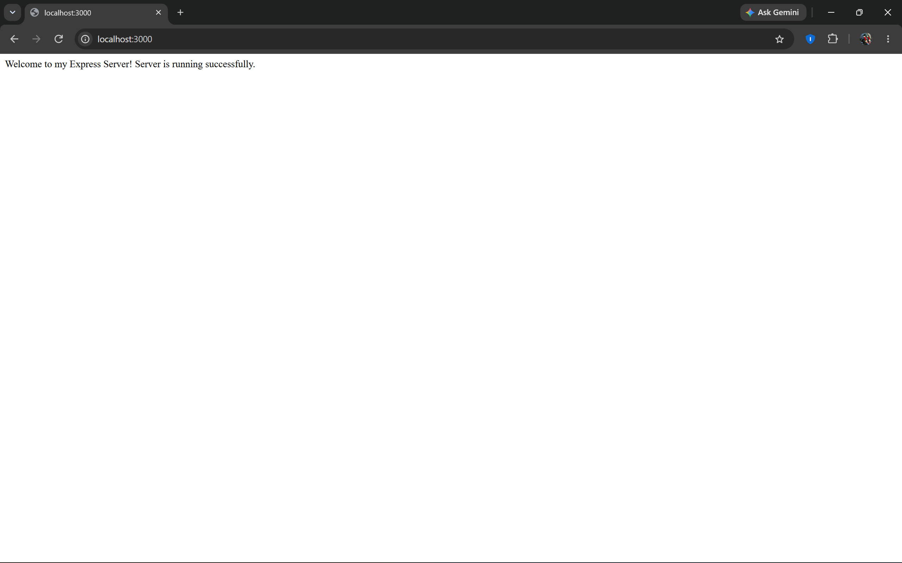
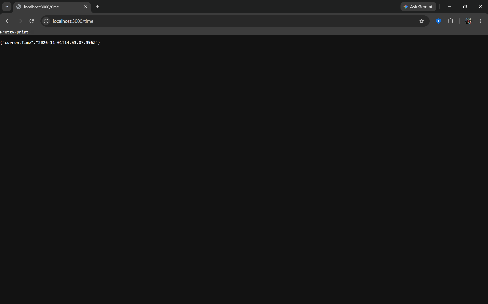
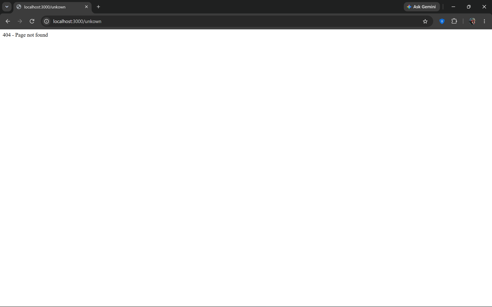
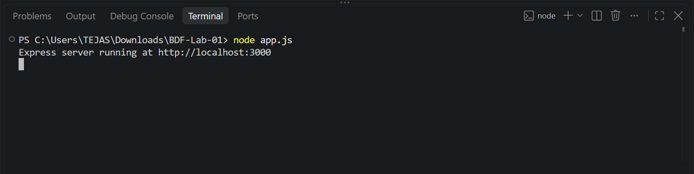

# Lab 01: Node.js and Express Server

## Student Details

- **Name:** TEJAS R
- **Registration Number:** 252U1R8093
- **Section:** CSE(QE)-2B - 204

**Deployed link:** [https://bdf-lab-01-mk68.onrender.com](https://bdf-lab-01-mk68.onrender.com)

## Objective

To understand the fundamentals of backend development by creating a basic HTTP server using Node.js and developing a web server using Express.js. The lab focuses on handling HTTP requests, implementing multiple routes, returning JSON responses, and managing invalid routes with appropriate HTTP status codes.

## Technologies Used

- Node.js
- Express.js
- JavaScript
- Visual Studio Code
- Git and GitHub
- Render (Deployment)

## Installation and Setup

1. Initialize the Node.js project:

   ```bash
   npm init -y
   ```

2. Install Express:

   ```bash
   npm install express
   ```

## How to Run

### Node.js HTTP Server

Run the following command:

```bash
node server.js
```

### Express Server

Run the following command:

```bash
npm start
```

## API Endpoints

- **GET /** — Displays the welcome message.
- **GET /about** — Returns student information as a JSON response.
- **GET /time** — Returns the current date and time.
- **Invalid Routes** — Returns a 404 Not Found response for routes that do not exist.

## Screenshots

### Home Page



### About Page


### Time Page



### Not Found Page



### Terminal Output



## Notes

- `package.json` contains project information, scripts, and dependencies.
- `node_modules` contains the installed Node.js packages.
- The Node.js built-in `http` module is used to create the basic HTTP server.
- Express.js is used to handle routes and HTTP responses.
- Git and GitHub are used for version control and project management.
- Render is used to deploy the Express application.